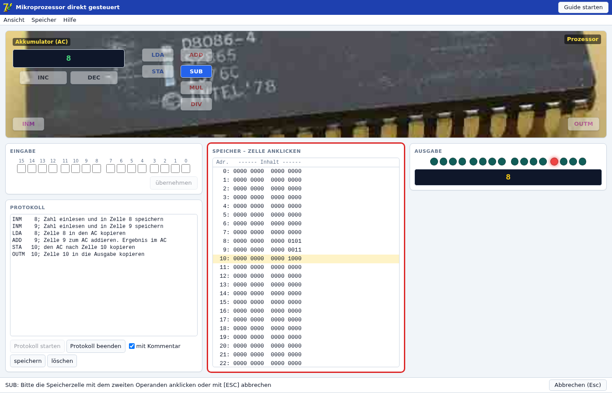
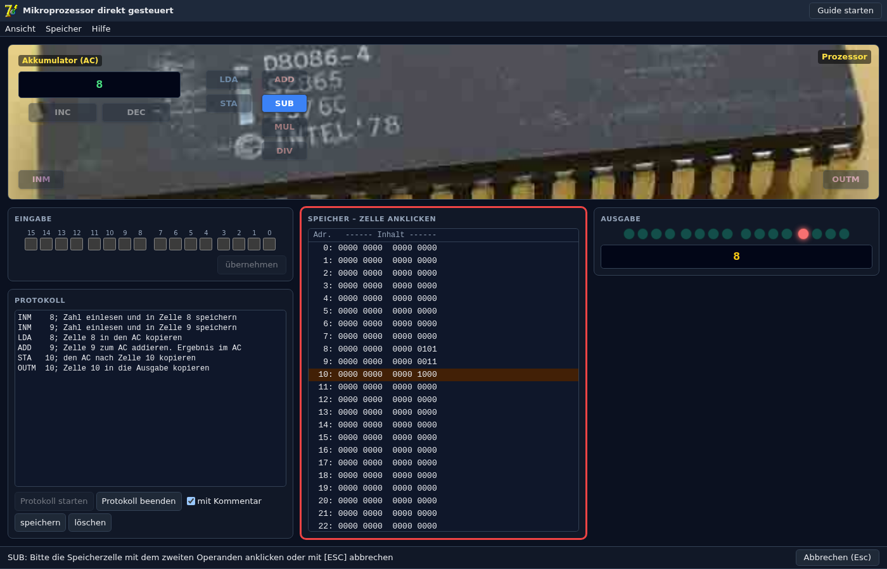
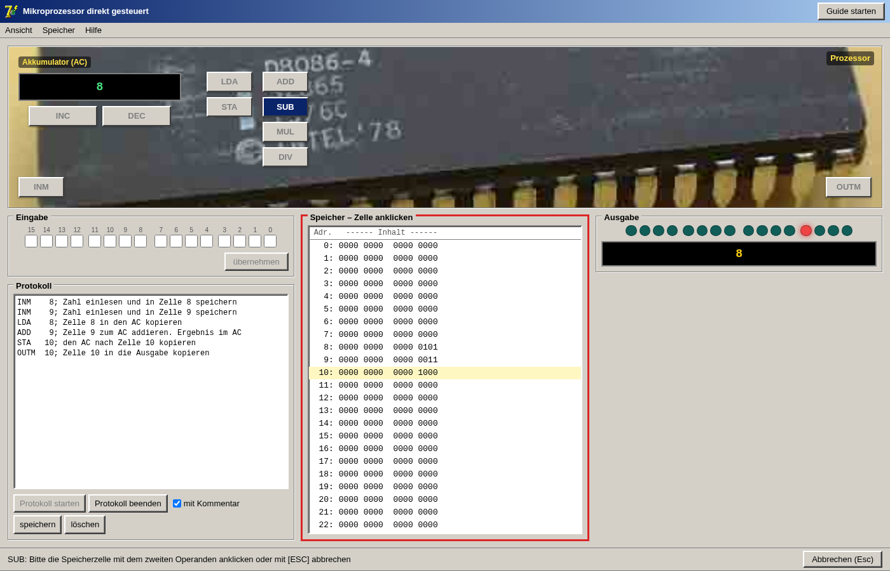
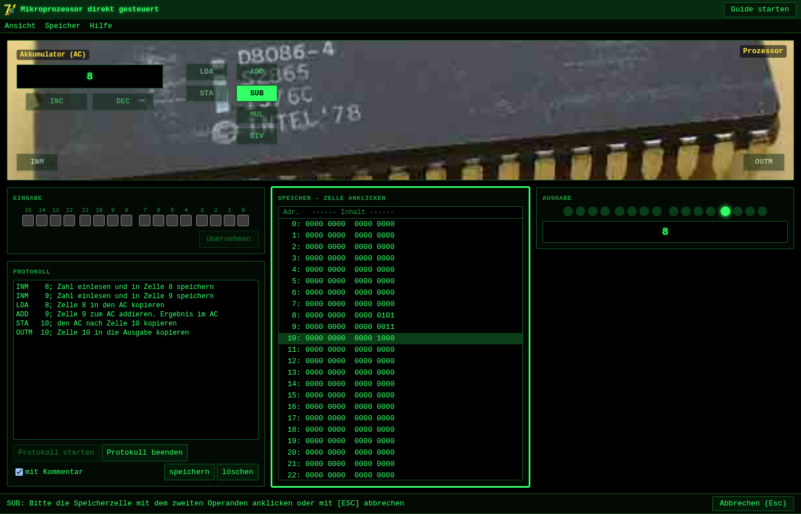

# CPU-Direkt – Web-Version

Nachbau des Unterrichtsprogramms **CPU-Direkt** („Mikroprozessor direkt gesteuert“) als Webapp im Browser, ohne Installation und ohne Server-Backend.



| Dunkel | Klassisch | Terminal |
|---|---|---|
|  |  |  |

## Funktionen

- **Prozessor** mit Akkumulator (AC) und **Speicher** aus 256 Zellen à 16 Bit, wie im Original
- Die Maschine ist **nicht programmierbar**: Jeder Befehl wird per Klick sofort ausgeführt. Befehle mit Speicherzelle (`LDA`, `STA`, `ADD`, `SUB`, `MUL`, `DIV`, `AND`, `OR`, `XOR`, `INM`, `OUTM`) warten danach auf einen Klick in den Speicher; [Esc] bricht ab.
- **Eingabe** binär über 16 Kästchen, **Ausgabe** über 16 „LEDs“ und dezimal (negative Werte zusätzlich im Zweierkomplement)
- **Protokoll** der ausgeführten Befehle, wahlweise mit Kommentar; Start/Stopp, Speichern als Textdatei
- Statuszeile und Meldungen (z. B. Division durch 0) mit den Texten des Originals
- **Ansicht:** AC dezimal oder binär; Increment/Decrement, Schiebebefehle, Negation und Logikbefehle einzeln einblendbar; CPU-Bild ein/aus
- **Guide** („Guide starten“): interaktive Tour, die `5 + 3` Schritt für Schritt vorführt
- **Hilfe:** Hilfetext und Befehlsübersicht des Originals, „Fehler melden“ (öffnet ein neues [GitHub-Issue](https://github.com/tinkeredu/giscpud/issues))
- **Skins:** Automatisch (folgt Hell/Dunkel des Systems), Hell, Dunkel, Klassisch (Windows-Look) und Terminal
- Speicher, AC, Protokoll und Einstellungen bleiben im Browser gespeichert

## Befehle

| Gruppe | Befehle |
|---|---|
| Transport | `LDA` `STA` |
| Ein-/Ausgabe | `INM` `OUTM` |
| Arithmetik | `ADD` `SUB` `MUL` `DIV` `INC` `DEC` |
| Logik/Schieben | `AND` `OR` `XOR` `NEG` `SHL` `SHR` |

Alle Werte sind 16 Bit breit und laufen über (z. B. `DEC` bei 0 ergibt 65535 = −1). `MUL`/`DIV` rechnen vorzeichenlos, `NEG` invertiert alle Bits, `SHR` schiebt logisch.

## Lokal starten

Benötigt [Node.js](https://nodejs.org) ≥ 22.12.

```sh
npm install
npm run dev      # Entwicklungsserver auf http://localhost:5173
```

Statische Version bauen:

```sh
npm run build    # Ergebnis in dist/ (relative Pfade)
npm run preview  # gebaute Version lokal ansehen
```

Den Ordner `dist/` kann man auf jeden Webspace legen, z. B. GitHub Pages oder den Schulserver. Über `file://` (Doppelklick auf `index.html`) funktioniert er nicht, weil Browser dort Module blockieren.

## Entwicklung

```sh
npm test         # Rechner-Tests (Vitest)
npm run lint     # oxlint
npm run build    # Typecheck + Produktionsbuild
```

| Pfad | Inhalt |
|---|---|
| `src/core` | Rechner: Befehle, Speicher, Protokoll (UI-unabhängig, getestet) |
| `src/app` | React-Oberfläche: Panels, Menüs, Guide, Skins |
| `public/docs` | Hilfe und Befehlsübersicht (HTML des Originals) |

Technik: React 19, TypeScript, Vite, Tailwind CSS 4.

Vom Original lag kein Quellcode vor. Layout, Texte und Bild stammen aus den Ressourcen der EXE; das Rechenverhalten (Überlauf, Vorzeichen, Fehlermeldungen) wurde am Original unter Wine nachgemessen.
